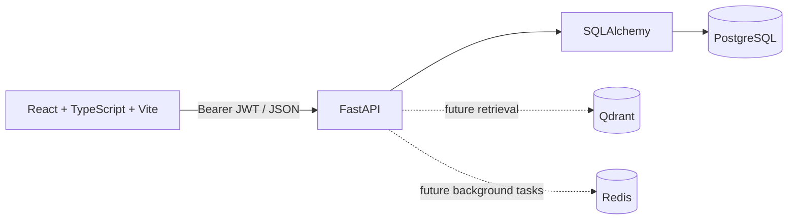

# Architecture

## Phase 1 deployment view

The frontend never receives provider secrets. Authentication is stateless JWT; password hashes use bcrypt. User-owned profile records are selected by the verified JWT subject. CORS is restricted to the configured frontend origin. SQLAlchemy models are kept separate from Pydantic schemas and route handlers.

## Planned AI request path

Typed API request -> authenticated service -> workflow router (LangGraph) -> specialized agent/service -> optional LangChain model adapter or hybrid retrieval -> structured response -> persistence/audit record. RAG payloads must include and filter on `user_id` for private material. Consequential external operations require a human approval record before execution. Resume parsing, model calls, voice/audio handling, and code evaluation are not represented as complete until their providers and secure execution paths exist.

## Phase 1 data model

`users` stores login identity and password hash. `user_profiles` stores display name, target role, and experience level. `career_goals` stores user-owned goal records. They use foreign keys and cascade deletion. Later domain tables should use the same user ownership boundary, indexed foreign keys, explicit retention rules, and migration-managed schema changes.
